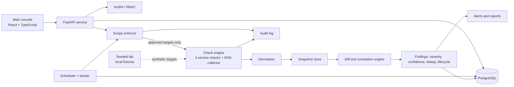

# A3-PS011-TC363

# SURFACEZERO

# Youtube video : https://youtube.com/shorts/AozltNnnx7s

**Authorised Attack-Surface Inventory and Change Monitor**
AIORI-3 Cybersecurity Hackathon · Problem Statement **PS-011**

> SURFACEZERO continuously inventories the DNS records, TLS certificates and exposed services of an **explicitly authorised lab portfolio**, compares each run against an approved baseline, and raises evidence-backed, explainable alerts when something changes.

**Team:** `Singularity` · **Members:** `Kirti Singh , Vedansh Chamoli` · **Mentor:** `Vinay Patel`

> **Status:** this README is the design and usage contract for the project. Sections marked *(planned)* describe behaviour that is specified but not yet implemented. The evaluation numbers in this document are intentionally empty. They are filled in only from `make demo` output, never by hand.

---

## Table of contents

1. [Problem](#1-problem)
2. [What SURFACEZERO does](#2-what-surfacezero-does)
3. [Requirement coverage (PS-011)](#3-requirement-coverage-ps-011)
4. [Architecture](#4-architecture)
5. [The four documented service checks](#5-the-four-documented-service-checks)
6. [Scope enforcement and threat model](#6-scope-enforcement-and-threat-model)
7. [Change-intelligence engine](#7-change-intelligence-engine)
8. [Finding model](#8-finding-model)
9. [Potential dangling DNS detection](#9-potential-dangling-dns-detection)
10. [The seeded lab](#10-the-seeded-lab)
11. [Quick start](#11-quick-start)
12. [Demo walkthrough](#12-demo-walkthrough-for-mentors)
13. [Evaluation and false-positive analysis](#13-evaluation-and-false-positive-analysis)
14. [API overview](#14-api-overview)
15. [Data model](#15-data-model)
16. [Repository layout](#16-repository-layout)
17. [Testing](#17-testing)
18. [Known limitations](#18-known-limitations)
19. [Ethics and responsible use](#19-ethics-and-responsible-use)
20. [Deliverables checklist](#20-deliverables-checklist)

---

## 1. Problem

Organisations accumulate exposed assets over time: forgotten test subdomains, expired TLS certificates, unexpected open ports, and CNAME records that still point at decommissioned cloud resources. Point-in-time scanners find these once, but the useful signal is **change over time** against a known-good baseline.

PS-011 asks for an authorised system that:

- discovers and tracks domains, DNS records, TLS certificates and selected exposed services for a defined organisation (max **20 domains and 10 hosts**),
- compares scheduled snapshots and raises actionable alerts,
- detects seeded **expired certificates**, **unexpected services** and **potential dangling DNS records**,
- reports false positives,
- stays strictly inside written, organiser-approved scope, with **no exploitation, no unrestricted scanning, and no claim that every dangling record is exploitable**.

## 2. What SURFACEZERO does

1. **Register** an organisation, its approved domains/hosts, and its allowed ports.
2. **Authorise**: scope is a signed-off record, not a checkbox. Every network operation re-validates against it.
3. **Baseline**: run all checks once and store the result as the approved snapshot.
4. **Monitor**: run scheduled scans, normalise observations, and diff against the baseline and the previous run.
5. **Explain**: every finding carries evidence, severity, confidence, a false-positive explanation and a recommended next action.
6. **Track**: findings move through a lifecycle (open, acknowledged, investigating, resolved, reopened) with deduplication and recurrence tracking.
7. **Evaluate**: a deterministic seeded lab proves the detections work and measures precision and recall.

Design principles:

- **Evidence over assertion.** Findings are separated into *verified facts*, *suspicious indicators*, *inferred risks* and *unknown*.
- **Deterministic core.** All detection rules are plain, versioned, testable code. No LLM sits in the detection path.
- **Absence of evidence is not evidence of absence.** A timeout never deletes an asset.
- **Candidates, not verdicts.** Dangling DNS is reported as a candidate that needs verification.

## 3. Requirement coverage (PS-011)

| PS-011 requirement | Where it is addressed | Status |
|---|---|---|
| Monitor up to 20 domains and 10 hosts | Hard caps enforced in scope registration | *(planned)* |
| Check selected ports using 4 documented checks | [Section 5](#5-the-four-documented-service-checks) | *(planned)* |
| Track domains, DNS records, TLS certs, exposed services | Inventory and snapshots ([Section 7](#7-change-intelligence-engine)) | *(planned)* |
| Scheduled inventory comparisons | Scheduler and diff engine | *(planned)* |
| Detect seeded expired certificates | Scenario S1 | *(planned)* |
| Detect seeded unexpected services | Scenario S2 | *(planned)* |
| Detect seeded potential dangling DNS | Scenario S3 | *(planned)* |
| Report false positives | Scenarios S4-S8 and [Section 13](#13-evaluation-and-false-positive-analysis) | *(planned)* |
| Written, organiser-approved scope only | [Section 6](#6-scope-enforcement-and-threat-model) | *(planned)* |
| No exploitation, no unrestricted scanning, no "all dangling = exploitable" | Design constraints, tested | *(planned)* |
| Alert and change reports | Reports module | *(planned)* |
| Final technical report, demo, pseudocode | `docs/` | *(planned)* |

## 4. Architecture



**Key decisions and trade-offs**

| Decision | Reason | Trade-off |
|---|---|---|
| Single FastAPI service plus one worker process | 30 assets do not need microservices. Fewer moving parts means a reliable demo. | Does not scale horizontally as-is. |
| PostgreSQL with Alembic migrations | Relational history, constraints and reproducible schema. | Heavier than SQLite, so a Compose file is provided. |
| DB-backed job table with an in-process scheduler | Idempotent, inspectable jobs without a broker. | Not suited to thousands of concurrent jobs. |
| Scope enforcer as one shared module | API and worker use the same code path, so the worker cannot bypass scope. | Single point of correctness, so it receives the heaviest testing. |
| Deterministic rules, versioned | Explainable, testable, reproducible evaluation. | Less flexible than heuristics. We accept that for credibility. |

## 5. The four documented service checks

PS-011 asks for four documented checks against selected ports. DNS is treated as an **inventory collector** (it feeds the change and dangling-DNS rules) and is deliberately *not* counted as one of the four, so no observation is double-counted.

| ID | Check | Purpose | Key evidence |
|---|---|---|---|
| **C1** | TCP connect | Is an approved port open, closed or filtered? | Result, latency, timestamp, resolved IP |
| **C2** | HTTP/HTTPS probe | Is a web endpoint responding, and what does it say? | Status, redirect chain (each hop re-validated), `Server` header, title hash |
| **C3** | TLS handshake and certificate | Is the certificate valid, matching and unexpired? | Subject, SAN, issuer, fingerprint, not-before/after, hostname match, days to expiry |
| **C4** | Banner and protocol identification | What service answers on a non-HTTP port? Is it expected? | Protocol guess, greeting banner (truncated), match against the approved service list |

Each check is documented in `docs/checks/` with:

- purpose, input schema, output schema,
- allowed targets and ports,
- timeout and retry policy,
- failure conditions,
- evidence collected,
- false-positive risks,
- the unit and integration tests that cover it.

**Defaults** *(planned, configurable)*: connect timeout 3 s, read timeout 5 s, one retry on timeout, bounded concurrency, per-target rate limit. Checks are read-only and non-intrusive: connect, handshake, `GET`/`HEAD`, and read the greeting. They send no payloads, credentials or exploit traffic.

**DNS collector** (not one of the four): resolves A, AAAA, CNAME, MX, NS and TXT for approved domains, records the exact chain and response code, and normalises the result (lowercase, trailing dot removed, sorted record sets).

## 6. Scope enforcement and threat model

The written authorisation is a **hard security boundary**.

**Scope record** contains: organisation, approved domains and hosts, approved ports per host, approver, authorisation reference, validity window, and an explicit flag for private or loopback lab targets.

**Enforcement rules** *(planned)*:

1. **Check immediately before every network operation**, not just at scan creation.
2. **Resolve then verify.** The target is resolved and the resulting IP is checked against the allowlist, then the connection is made to that *validated IP* (rebinding-aware).
3. **Redirects are re-validated** hop by hop. A redirect to an out-of-scope host is refused and recorded.
4. **Port allowlist** per host. Anything else is rejected.
5. **No arbitrary targets.** Scan requests reference registered assets by ID, never free-text hosts.
6. **Private and loopback ranges** are blocked unless the scope explicitly authorises them (the seeded lab does).
7. **Worker parity.** The worker imports the same enforcer, and tests assert that a worker job for an out-of-scope target fails.
8. **Dry-run mode** prints the exact targets, ports and checks that *would* run, then exits.
9. **Audit log** records scope changes, scan starts and every allow/deny decision.

**Threat model summary**

| Threat | Mitigation |
|---|---|
| Operator or API caller injects an out-of-scope target | Asset-ID-only API, schema validation, enforcer check |
| DNS rebinding or a CNAME pointing out of scope | Resolve-then-verify, connect to the validated IP |
| Redirect to an internal or third-party host | Per-hop validation |
| Tool abused as an open scanner (SSRF-style) | Allowlists, bounded concurrency, rate limits, no free-form targets |
| Worker bypasses API restrictions | Shared enforcer, enforced in the worker, with tests |
| Secret leakage | Environment-based secrets, sanitised errors |
| Tampering with scope history | Append-only audit log |

**Out of scope for the tool itself:** exploitation, credential attacks, brute-forcing, stealth, destructive actions, and any attempt to claim or modify a third-party resource.

## 7. Change-intelligence engine

The centrepiece. Observations are normalised, attached to **stable asset identifiers**, and stored in timestamped snapshots. Each run is diffed against the approved baseline and the previous run.

**Detected changes**

- new or removed domains and hosts
- new, removed or changed DNS records and resolved IPs
- services that appeared or disappeared
- **unexpected services** relative to the approved baseline
- certificates expired, near expiry, or with changed issuer, fingerprint, validity or hostname coverage
- potential dangling DNS indicators
- repeated failures, observation gaps and recovery

**Observation states:** `observed`, `changed`, `missing`, `unreachable`, `unverified`, `resolved`.

**Incomplete scans are handled explicitly:**

- A timeout produces `unreachable`, never `missing`.
- An asset becomes `missing` only after a configurable number of consecutive *successful* scans that did not see it.
- A failed observation never overwrites the last known good value. It is stored alongside it.
- Recovery after an outage or a remediation closes the related finding.

**Every change record includes:** previous value, current value, first observed, last observed, detection time, supporting evidence, severity, confidence and a recommended next action.

**Deduplication:** each finding has a deterministic fingerprint (`rule_id + rule_version + asset_id + normalised_key`). Re-detection updates `last_seen` and the recurrence count instead of creating a duplicate.

**Pipeline pseudocode**

```text
function run_inventory(org, trigger):
    scope   = load_scope(org)
    targets = scope.expand_approved_targets()          # assets x allowed ports
    job     = create_job(org, trigger, targets)        # idempotent on (org, schedule slot)

    observations = []
    for t in targets:                                  # bounded concurrency
        decision = scope_enforcer.check(t)             # resolve -> verify IP -> verify port
        audit.log(job, t, decision)
        if decision.denied:
            observations += [Observation(t, state="blocked", reason=decision.reason)]
            continue
        observations += [
            dns_collect(t), tcp_check(t), http_check(t), tls_check(t), banner_check(t)
        ]                                              # each returns evidence + state

    snapshot = normalise_and_store(job, observations)  # failures stored as unreachable
    prev     = latest_complete_snapshot(org, before=snapshot)
    base     = approved_baseline(org)

    changes  = diff(snapshot, prev, base)              # keyed by stable asset id
    for c in changes:
        for finding in apply_rules(c, history(c.asset)):   # versioned deterministic rules
            fp = fingerprint(finding)
            upsert_finding(fp, finding)                # dedupe, recurrence, severity, confidence
    auto_resolve_findings(snapshot)                    # condition no longer observed
    emit_alerts(new_or_escalated_findings)
    return report(job)
```

## 8. Finding model

Every finding answers five questions:

1. **What changed or looks suspicious?**
2. **What evidence supports it?**
3. **How confident are we?**
4. **What could make it a false positive?**
5. **What should the operator do next?**

Structured fields: stable ID, fingerprint, asset reference, category, severity, confidence, evidence with observation timestamps, rule ID and version, false-positive explanation, remediation guidance, lifecycle state, and related historical observations.

Findings are classified as **verified fact**, **suspicious indicator**, **inferred risk** or **unknown**.

**Severity** reflects potential impact (for example an expired certificate on a production-tagged host). **Confidence** reflects evidence quality (for example one failed lookup versus a repeated, corroborated pattern). They are scored and shown separately.

**Lifecycle:** `open → acknowledged → investigating → resolved`, with `reopened` on recurrence and `false_positive` as an operator-set terminal state that feeds the false-positive analysis.

## 9. Potential dangling DNS detection

A transparent, rule-based pipeline:

1. Find CNAME records whose target matches a **versioned provider-pattern list** (`rules/providers.yaml`).
2. Record the **exact CNAME chain, response code, timestamp and triggering rule**.
3. Look for corroborating indicators, such as NXDOMAIN on the target or a provider-specific "not found" response, when the check is in scope.
4. Separate **transient failure** (single SERVFAIL or timeout), **legitimate decommissioning** (record removed in the same change window), **unresolved evidence**, and **stronger indicators**.
5. Score confidence from evidence quality and state what **additional verification** is required.

Hard rules: a CNAME existing, or resolution failing, **never** means "vulnerable". The tool never attempts to claim, provision, modify or exploit any third-party resource. The output is always a *candidate requiring human verification*.

## 10. The seeded lab

A deterministic, isolated environment. All fixtures are **synthetic and labelled as such** in the UI and reports, so they cannot be mistaken for real internet measurements.

| ID | Scenario | Expected behaviour |
|---|---|---|
| **S1** | Expired TLS certificate | Finding raised for expired cert, evidence includes `not_after` and the check time |
| **S2** | Unexpected service appears after baseline | "Unexpected service" finding on the new port |
| **S3** | Potential dangling DNS (provider-pattern CNAME plus failing target) | Candidate finding, confidence below "confirmed", verification steps listed |
| **S4** | Benign DNS change (e.g. TTL or record reorder) | No finding, or informational change only |
| **S5** | Temporary timeout | `unreachable` recorded, **no** disappearance or finding |
| **S6** | Service disappears then returns | Marked `missing` only after the configured threshold, then recovers cleanly |
| **S7** | Certificate renewal | Existing S1 finding auto-resolves |
| **S8** | Harmless provider-style CNAME (target still resolves and serves content) | Not flagged as dangling (benign lookalike) |

For each scenario, `lab/scenarios/*.yaml` defines the initial state, the trigger, expected observations, expected finding, expected severity and confidence, expected false-positive behaviour, and expected resolution behaviour.

## 11. Quick start

> Commands below are the target interface. They will be verified and corrected once the implementation lands.

**Prerequisites:** Python 3.12, Node 20+, PostgreSQL 15+ (or Docker with Compose).

```bash
git clone <your-repo-url> surfacezero && cd surfacezero
cp .env.example .env          # set SECRET_KEY, DATABASE_URL, admin credentials

# Option A: Docker Compose
docker compose up --build

# Option B: local
make setup                    # venv, deps, frontend build
make migrate                  # Alembic migrations
make run                      # API + worker
```

Open `http://localhost:8000` (API docs at `/docs`).

One-command demo (initialises the lab, baselines, injects changes, scans, diffs, evaluates):

```bash
make demo
```

Dry-run (prints exactly what would be scanned, sends nothing):

```bash
make dry-run
```

Tests:

```bash
make test
```

## 12. Demo walkthrough (for mentors)

1. `make demo-reset`: clean state, no manual DB edits.
2. **Scope**: show the approved assets and ports, and the authorisation record. Try to add an out-of-scope target and watch it be rejected and audited.
3. **Dry-run**: show the exact target/check plan.
4. **Baseline**: create the baseline snapshot.
5. **Inject**: apply the seeded changes (S1-S8) from the Lab page.
6. **Scan and compare**: run the scan, open the change report.
7. **Findings**: open S1, S2 and S3 and walk through the five questions for each.
8. **False positives**: show S4, S5 and S8 producing no finding or a labelled non-finding.
9. **Recovery**: apply S7 (renewal) and watch the finding auto-resolve.
10. **Evaluation**: open Lab and Evaluation for expected-versus-actual results.

## 13. Evaluation and false-positive analysis

`make demo` writes `reports/evaluation.json` and `reports/evaluation.md`, containing scenarios executed, expected versus actual findings, true positives, false positives, false negatives, precision and recall (where labels support them), failed checks and run duration.

**Results (generated, not hand-edited):**

| Metric | Value |
|---|---|
| Scenarios executed | *to be filled from `evaluation.json`* |
| True positives | *to be filled* |
| False positives | *to be filled* |
| False negatives | *to be filled* |
| Precision / recall | *to be filled* |

Only measured values from the lab are reported. The lab is small and synthetic, so these numbers describe the seeded scenarios and **do not** predict real-world accuracy.

## 14. API overview

*(Planned. Final routes will be generated from the OpenAPI schema at `/docs`.)*

| Area | Endpoints |
|---|---|
| Auth | `POST /auth/login`, `GET /auth/me` |
| Scope and assets | `GET/POST /organizations`, `GET/POST /assets`, `GET/PUT /scope` |
| Monitoring | `POST /scans` (by asset IDs, dry-run supported), `GET /scans/{id}`, `GET/PUT /schedules` |
| Inventory | `GET /inventory`, `GET /snapshots`, `GET /changes` |
| Findings | `GET /findings`, `GET /findings/{id}`, `POST /findings/{id}/transition` |
| Lab | `POST /lab/reset`, `POST /lab/scenarios/{id}/apply`, `GET /lab/evaluation` |
| Reports | `GET /reports/{type}` |

Roles: `admin` (scope and users), `analyst` (findings and scans), `viewer` (read-only).

## 15. Data model

Core tables *(planned, managed by Alembic)*:

`organizations`, `scope_authorizations`, `assets`, `allowed_ports`, `scan_jobs`, `observations`, `snapshots`, `snapshot_items`, `changes`, `findings`, `finding_events`, `audit_log`, `users`, `lab_scenarios`, `evaluation_runs`.

Design notes: observations are immutable and append-only, assets have stable IDs separate from their hostnames, findings carry a unique fingerprint constraint for deduplication, and all queries are parameterised.

## 16. Repository layout

*(Target layout.)*

```text
surfacezero/
├── backend/
│   ├── app/            # API, auth, models
│   ├── scope/          # scope enforcer (shared by API and worker)
│   ├── checks/         # c1_tcp, c2_http, c3_tls, c4_banner, dns_collector
│   ├── inventory/      # normalisation, snapshots
│   ├── diff/           # change detection, correlation
│   ├── findings/       # rules, severity, confidence, lifecycle
│   ├── worker/         # scheduler, jobs
│   ├── reports/
│   ├── migrations/
│   └── tests/
├── frontend/           # React + TypeScript console
├── lab/                # fixture servers, fake resolver, scenarios/*.yaml
├── rules/              # providers.yaml, rule definitions (versioned)
├── docs/               # architecture, threat model, checks, report, demo script
├── reports/            # generated evaluation output
├── docker-compose.yml
├── Makefile
└── README.md
```

## 17. Testing

Planned coverage:

- scope enforcement, unauthorised-target rejection, worker parity
- DNS normalisation
- TLS expiry and hostname mismatch
- unexpected-service detection
- inventory comparison and incomplete-scan handling
- finding deduplication, lifecycle and recovery
- false-positive cases (S4, S5, S8)
- scheduled-job reliability and idempotency
- report generation
- authentication and access control
- end-to-end seeded-lab run

Test failures are reported as they are. They are not hidden or skipped.

## 18. Known limitations

- Synthetic lab results do not generalise to real networks.
- Dangling-DNS detection relies on a provider-pattern list that must be maintained and can lag new providers.
- Banner identification (C4) is heuristic and can misclassify unusual services.
- A single vantage point cannot rule out geo-dependent DNS or filtering.
- Designed for the PS-011 scale (up to 20 domains and 10 hosts), not large estates.
- Findings from timeouts or single observations carry reduced confidence by design.

**Future work:** multiple vantage points, certificate transparency feeds, notification integrations, exportable evidence bundles, historical change replay.

## 19. Ethics and responsible use

SURFACEZERO is for **authorised, written-scope lab use only**. It performs no exploitation, credential attacks, stealth or unrestricted scanning, and it never claims that a dangling DNS record is exploitable. Do not point it at systems you do not own or have explicit written permission to test.

Reference: [OWASP Web Security Testing Guide](https://owasp.org/www-project-web-security-testing-guide/)

---

*Licence: `MIT` · Built for AIORI-3.*
